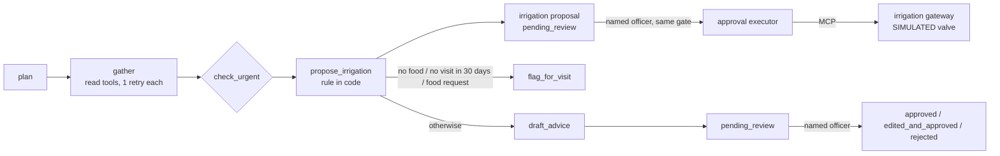

# AgriMoist AI: Architecture

## 1. What it is

An AI agent for an agricultural extension office in Karamoja, Uganda, that drafts
sourced advice for a group of farming households from visit records, farmer reports,
weather, simulated soil-moisture sensor readings and the crop calendar. A named
officer approves every draft before anything reaches a farmer.

**The AI drafts and proposes; a physical action happens only after a named officer
approves.** The one physical action is irrigation, and it is **simulated**: there is no
valve hardware, only a valve state in the database behind a simulated gateway.

## 2. Agent shape

- **Flow:** LangGraph in `backend/agent/graph.py`: plan → gather → check_urgent →
  propose_irrigation → draft or flag.
- **Retry rule:** each call to our own tools is retried once. If it still fails, the gap
  is written into the draft ("weather missing after one retry"), never guessed. A failed
  call to the borrowed clock is not retried; it is recorded as a gap.
- **Sources:** the `draft_advice` tool sets a draft to `blocked` if any fact has no
  source, or if the wording uses a number that appears in none of the sources.
- **Rain guard:** `draft_advice` also blocks a draft whose advice tells farmers to add
  water (water, irrigate, add water, ...) when the forecast in its weather source is at
  or above `HEAVY_RAIN_THRESHOLD_MM` (15 mm over 7 days). The model is told too
  ("Heavy rain is forecast: do not advise watering, even for dry plots."), but the
  block is in code, so it holds even when the model ignores that. The reason is shown
  on the run page.
- **Irrigation rule (code, not the model):** the `propose_irrigation` tool
  (`irrigation_check` in `backend/tools/agrimoist_tools.py`) reads the facts itself and
  proposes only when the plot's latest soil reading is current (the soil sensor's stale
  check) and below `IRRIGATION_DRY_THRESHOLD_PCT`, the weather is known and forecast rain
  is below `HEAVY_RAIN_THRESHOLD_MM` (`is_heavy_rain`, shared with the rain guard), and
  the plot has no open proposal or open valve. Minutes are capped at
  `IRRIGATION_MAX_MINUTES`. If the run's own weather or soil read was a gap, the agent
  proposes nothing.
- **Proposals use the same gate:** a proposal is an `Advice` row (status
  `pending_review`) plus an `IrrigationProposal` row, so `load_decidable` and
  `apply_decision` handle it exactly like advice: signed-in officer, expiry
  (`DRAFT_EXPIRY_HOURS`), decide-once, web and USSD (listed as "IRRIGATE H-009 20 min").
  It cannot be edited, is not translated, and is never in the farmer view.
- **Approval executor:** after an approval is committed, `apply_decision` hands the
  proposal to `backend/approvals/irrigation_executor.py`, the only code that calls the
  valve tools. It claims the proposal once (a conditional UPDATE), calls `open_valve`
  over MCP, and on any error closes the valve through the gateway, or marks it closed
  directly if the gateway cannot be reached (fail closed). The approval stands either
  way. Each step is logged with the channel and officer.
- **Approval gate:** `backend/approvals/router.py` is the only code that sets
  `approved` or `edited_and_approved` (apart from one pre-approved demo seed record). Rejecting needs a reason, and every decision is
  logged with the officer who made it.

## 3. MCP servers

| | Server | Tools |
|---|---|---|
| **Built** | `backend/mcp_server/server.py` | **Read only (6):** `get_field_records`, `get_plot_history`, `get_crop_calendar`, `get_weather`, `get_pest_reports`, `get_soil_moisture`. **Saves a record:** `record_observation`. **Acts:** `draft_advice`, `flag_for_visit`, `schedule_followup`. **Proposes:** `propose_irrigation` (5 that write, 11 tools) |
| **Borrowed** | `mcp-server-time` (official MCP reference server) | `get_current_time` for Africa/Kampala |
| **Built, simulated device** | `backend/irrigation_server/server.py` (`irrigation-gateway`) | `open_valve`, `close_valve`, `valve_status`. **Not connected to the agent.** |

The agent calls its two servers over the real MCP protocol, not as direct Python function
calls: `backend/agent/mcp_client.py` starts each one as a subprocess over stdio, once
per agent run. Every call to both servers is written to the log, with its inputs,
output or error, and the agent run it belongs to.

To see this in the app, the officer screen **AI tools (MCP)** (`/mcp`, JSON at
`/api/mcp`) starts both servers the same way and lists the tools they report over the
protocol. Our server also runs on its own for any MCP client
(`python -m backend.mcp_server.server --demo-data`, registered in `.mcp.json`).

**Why borrow the clock:** the agent needs an authoritative "today" to judge whether a
planting window has closed, and timezone-safe clock handling is a small, well-solved
problem where borrowing beats writing.

**Why these tool boundaries:** each tool is one thing an extension officer would
recognise (read the visits, check the weather, flag a visit, book a follow-up). No
tool the agent can reach can send anything to a farmer, order inputs, request credit or
open a valve; the strongest it can do is put a draft or a proposal in the officer's
queue.

**The irrigation gateway is simulated, and kept apart.** `IrrigationGatewayClient` in
`backend/agent/mcp_client.py` registers it the same way as the other servers, but the
agent's `ToolClient` never opens it; only the approval executor does. The gateway also
checks for itself that a proposal was approved before `open_valve` acts, and that the
minutes match it. Each valve row stores its close time; the gateway closes overdue
valves before every call, and the app closes them on start-up and every
`IRRIGATION_SWEEP_SECONDS`, so a restart never leaves a valve open past its time.

**Soil moisture is simulated.** There is no sensor hardware. `get_soil_moisture` reads
the `SoilReading` table, whose readings are labelled `simulated sensor`; the ones in
the demo seed are also marked `demo`. A reading older than 24 hours is `stale`: the
agent checks the age again itself (`split_soil_readings` in `backend/agent/graph.py`),
never passes a stale value to the model, and lists it in the sources only as "out of
date and not used". Current readings are cited as `soil_sensor` sources, so the
unsourced-number check covers any moisture figure in a draft.

## 4. Model

`openai/gpt-oss-120b`, an open-weights model, served through Groq for the hackathon.
Because the weights are open, the same model could be run in-country.

Approved advice is translated into Ngakarimojong by Sunbird AI (`sunflower-9b`), with
the Groq model as a backup (`backend/agent/model_client.py`, called from
`backend/approvals/router.py` only after approval). A translation that changes any
number is discarded, and the farmer sees the approved English text. The farmer page's
voice reader uses Sunbird text-to-speech (`backend/agent/model_client.py`, served by
`backend/farmer/router.py`). Sunbird has no Karamojong voice, so Karamojong is read
with its Ateso voice.

With no `GROQ_API_KEY`, drafting falls back to a deterministic
rule-based mode, labelled `rule-based-stub` in the log.

## 5. Channels and data

- **One app:** a single FastAPI app and one SQLite database serve the officer screens,
  the farmer web page (`/farmer`) and a simulated USSD menu (`/ussd`).
- **Farmers only see approved advice:** they read it through the
  `advice_visible_to_farmer` database view, which contains only `approved` and
  `edited_and_approved` advice.
- **Logged:** every agent tool call, officer decision and saved farmer action is
  written to the log, and each agent run records its model and cost. Voice playback,
  sign-ins and the weather shown on screens are not logged.

## 6. Honest limits

See [Known gaps in the README](README.md#known-gaps) and [EVALS.md](EVALS.md) for the
measured results, including the failures.
