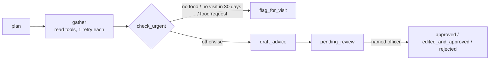

# AgriMoist AI: Architecture

## 1. What it is

An AI agent for an agricultural extension office in Karamoja, Uganda, that drafts
sourced advice for a group of farming households from visit records, farmer reports,
weather and the crop calendar. A named officer approves every draft before anything
reaches a farmer.

## 2. Agent shape

- **Flow:** LangGraph in `backend/agent/graph.py`: plan → gather → check_urgent →
  draft or flag.
- **Retry rule:** each tool call is retried once. If it still fails, the gap is written
  into the draft ("weather missing after one retry"), never guessed.
- **Sources:** the `draft_advice` tool sets a draft to `blocked` if any fact has no
  source, or if the wording uses a number that appears in none of the sources.
- **Approval gate:** `backend/approvals/router.py` is the only code that sets
  `approved` or `edited_and_approved`. Rejecting needs a reason, and every decision is
  logged with the officer who made it.

## 3. MCP servers

| | Server | Tools |
|---|---|---|
| **Built** | `backend/mcp_server/server.py` | **Read only:** `get_field_records`, `get_plot_history`, `get_crop_calendar`, `get_weather`, `get_pest_reports`. **Saves a record:** `record_observation`. **Acts:** `draft_advice`, `flag_for_visit`, `schedule_followup` |
| **Borrowed** | `mcp-server-time` (official MCP reference server) | `get_current_time` for Africa/Kampala |

The agent calls both servers over the real MCP protocol, not as direct Python function
calls: `backend/agent/mcp_client.py` starts each one as a subprocess over stdio, once
per agent run. Every call to both servers is written to the log, with its inputs,
output or error, and the agent run it belongs to.

To see this in the app, the officer screen **AI tools (MCP)** (`/mcp`, JSON at
`/api/mcp`) starts both servers the same way and lists the tools they report over the
protocol. Our server also runs on its own for any MCP client
(`python -m backend.mcp_server.server --demo-data`, registered in `.mcp.json`).

**Why borrow the clock:** the agent needs an authoritative "today" to judge whether a
planting window has closed, and timezone-safe clock handling is a small, well-solved
problem where borrowing beats writing.

**Why these tool boundaries:** each tool is one thing an extension officer would
recognise (read the visits, check the weather, flag a visit, book a follow-up). No
tool can send anything to a farmer, order inputs or request credit; the strongest a
tool can do is put a draft in the officer's queue.

## 4. Model

`openai/gpt-oss-120b`, an open-weights model, served through Groq for the hackathon.
Because the weights are open, the same model could be run in-country. It also tries
to translate approved advice into Ngakarimojong, but cannot, so farmers see the
approved English text. With no `GROQ_API_KEY`, drafting falls back to a deterministic
rule-based mode, labelled `rule-based-stub` in the log.

## 5. Channels and data

- **One app:** a single FastAPI app and one SQLite database serve the officer screens,
  the farmer web page (`/farmer`) and a simulated USSD menu (`/ussd`).
- **Farmers only see approved advice:** they read it through the
  `advice_visible_to_farmer` database view, which contains only `approved` and
  `edited_and_approved` advice.
- **Everything is logged:** every tool call, officer decision and farmer action is
  written to the log, and each agent run records its model and cost.

## 6. Honest limits

See [Known gaps in the README](README.md#known-gaps) and [EVALS.md](EVALS.md) for the
measured results, including the failures.
