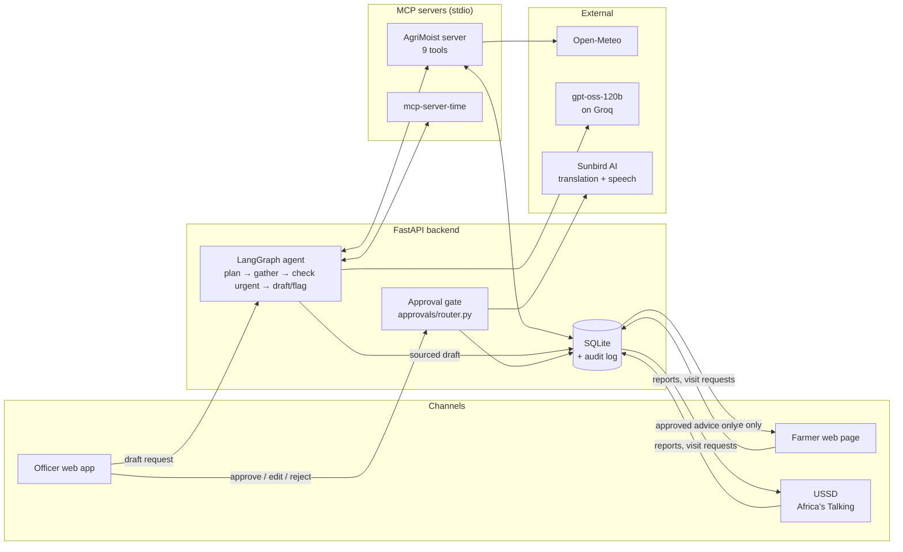

<div align="center">

# AgriMoist AI

**An agentic field assistant for agricultural extension officers in Karamoja, Uganda.**

The agent turns weather, pest and field-visit data into sourced, plot-specific advice.
A named extension officer approves every word before it reaches a farmer.

[](https://www.python.org/)
[](https://fastapi.tiangolo.com/)
[](https://github.com/langchain-ai/langgraph)
[](https://modelcontextprotocol.io/)
[](LICENSE)

[**Live demo**](https://agri-moist-ai.onrender.com) ·
[**Quick start**](#quick-start-clone-and-run-with-one-command) ·
[Architecture](ARCHITECTURE.md) ·
[Evaluation results](EVALS.md) ·
[API contract](docs/API_CONTRACT.md) ·
[Tool contract](docs/TOOL_CONTRACT.md)

</div>

---

> **Agentic AI for Africa Challenge** · Agriculture & Food Security track · Climate-smart advisory theme

| 9 | 2 | 37 / 42 | 141 | ~$0.0008 |
| :---: | :---: | :---: | :---: | :---: |
| MCP tools in our server | MCP servers used by the agent | Evaluation score (final check) | Automated tests | Model cost per agent run |

## Table of contents

- [The problem](#the-problem)
- [The solution](#the-solution)
- [Key features](#key-features)
- [Architecture](#architecture)
- [Technology stack](#technology-stack)
- [Getting started](#getting-started)
- [Configuration](#configuration)
- [Demo walkthrough](#demo-walkthrough)
- [Safety guarantees](#safety-guarantees)
- [MCP integration](#mcp-integration)
- [Evaluation](#evaluation)
- [Data sources](#data-sources)
- [Testing](#testing)
- [Project structure](#project-structure)
- [Known limitations](#known-limitations)
- [Roadmap](#roadmap)
- [Team](#team)
- [Acknowledgements](#acknowledgements)
- [Licence](#licence)

## The problem

District extension offices in Karamoja, such as the Napak District Production Office,
have one or two officers serving far more smallholder households than they can visit in
a season. Advice that fits a plot means cross-checking each household's plot history
against rainfall, pest sightings and the crop calendar. By hand, that does not scale, so
most households never get timely advice for their own plot.

Karamoja has a single, unreliable rainy season. Advice that comes late or is wrong costs
a household its harvest.

## The solution

AgriMoist AI gives each officer an AI assistant that does the checking and drafting.
The officer keeps the judgement.

1. **Collect.** Officers record field visits. Farmers report pests, rain and crop problems from any phone.
2. **Check.** The agent gathers plot history, live weather, nearby pest reports and the crop calendar through MCP tools.
3. **Draft.** An open-weights model writes advice in which every fact cites its source. Urgent cases are flagged for a visit instead.
4. **Approve.** A named officer approves, edits or rejects each draft. Nothing reaches a farmer without that approval.
5. **Follow up.** Farmers read approved advice by USSD or on the web, in English or Ngakarimojong, and say whether it helped.

**Users**

| User | What they do |
| --- | --- |
| Extension officers | Record visits, review sourced drafts, approve advice, respond to flagged households |
| Farming households | Read approved advice, report problems, request visits and give feedback, on a basic phone (USSD) or a smartphone |

## Key features

- **Auditable agent pipeline.** A fixed LangGraph flow (plan → gather → check urgent → draft or flag) with live step-by-step progress streamed to the officer.
- **Human-in-the-loop approval gate.** Farmers only ever read from a database view that contains approved advice.
- **Source-checked drafts.** A draft with an unsourced fact, or with a number that appears in none of its sources, is blocked before it reaches the queue.
- **Graceful degradation.** A failed tool call is retried once and then recorded as a visible gap. The agent never guesses a missing value.
- **Two MCP servers.** Our own 9-tool AgriMoist server, plus the borrowed reference server `mcp-server-time`, both connected over stdio.
- **Basic-phone access.** A USSD menu compatible with Africa's Talking, plus an in-browser handset simulator.
- **Local language.** Approved advice is translated into Ngakarimojong by Sunbird AI. Translations that change any number are rejected.
- **Voice reader.** Farmers can have their page read aloud in English, Swahili or Karamojong, using Sunbird AI's Ugandan voices. Speech is generated in short pieces and prepared in the background when the page opens. Each piece is generated once, stored by the app, and kept by the phone, so listening again uses no data.
- **Built for weak signal.** The farmer page keeps a copy of the farmer's own data on the phone. It opens instantly, and when there is no connection it still shows the last approved advice, clearly labelled as saved. Signing out removes the copy, because farm phones are often shared.
- **Full audit log.** Every tool call, officer decision and farmer action is logged with its inputs, outputs, source, actor and cost.

## Architecture



The agent lives in `backend/agent/graph.py`. Each call to our own tools is retried once,
and a second failure is written into the draft as a gap. A failed call to the borrowed
clock is not retried; it is recorded as a gap. Urgent signals (no food left, an overdue
visit, a food-related visit request) route the group to `flag_for_visit` instead of
drafting advice. See [ARCHITECTURE.md](ARCHITECTURE.md) for the full design.

## Technology stack

| Layer | Choice |
| --- | --- |
| Language | Python 3.12 |
| Web framework | FastAPI, uvicorn, Jinja2 templates with plain JavaScript (no build step, light on weak connections) |
| Agent | LangGraph |
| Tools | Official `mcp` Python SDK (FastMCP); borrowed [`mcp-server-time`](https://pypi.org/project/mcp-server-time/) |
| Model | [`openai/gpt-oss-120b`](https://huggingface.co/openai/gpt-oss-120b) (open weights, Apache 2.0), served by [Groq](https://groq.com); deterministic rule-based fallback when no key is set |
| Translation and speech | [Sunbird AI](https://sunbird.ai): `sunflower-9b` translation and Orpheus text-to-speech |
| Persistence | SQLite via SQLModel / SQLAlchemy |
| External data | [Open-Meteo](https://open-meteo.com) weather; [FEWS NET](https://fews.net) crop calendar |
| Testing | pytest (141 tests) and a 14-task evaluation harness |
| Deployment | Docker and Docker Compose; hosted demo on Render |

## Getting started

### Quick start: clone and run with one command

The only requirement is [Python 3.12 or newer](https://www.python.org/downloads/) and Git.
No API keys are needed: without them the app runs end to end in its built-in
rule-based mode.

**macOS / Linux**

```bash
git clone https://github.com/VictoriaMirembe/Agri-moist-AI.git && cd Agri-moist-AI && ./run.sh
```

**Windows (PowerShell)**

```powershell
git clone https://github.com/VictoriaMirembe/Agri-moist-AI.git; cd Agri-moist-AI; .\run.bat
```

Then open **<http://localhost:8000>** for the officer screens and
**<http://localhost:8000/farmer>** for the farmer page. You can also double-click
`run.bat` in File Explorer.

The script:

1. Finds Python 3.12+
2. Creates a virtual environment in `.venv`
3. Installs the requirements
4. Creates `.env` from `.env.example`
5. Starts the app, which creates and seeds its database on first start

Running it again skips the steps that are already done, so later starts take only a
few seconds. To use a different port, set `APP_PORT` (for example `APP_PORT=8080 ./run.sh`).

To enable the real model, Karamojong translation and Sunbird voices, add your keys to
`.env` (see [Configuration](#configuration)) and run the script again.

### Run with Docker

```bash
git clone https://github.com/VictoriaMirembe/Agri-moist-AI.git
cd Agri-moist-AI
cp .env.example .env
docker compose up --build
```

Open <http://localhost:8000>. On first start, the app creates its database and loads the
synthetic demo households.

### Run manually (without the script)

```bash
python -m venv .venv
source .venv/bin/activate          # Windows: .venv\Scripts\activate
pip install -r requirements.txt
cp .env.example .env
uvicorn backend.main:app --reload
```

<details>
<summary><strong>Windows (PowerShell) notes</strong></summary>

Use the standard Windows CPython from python.org, not the MSYS runtime:

```powershell
py -3.12 -m venv .venv
.\.venv\Scripts\python.exe -m pip install --upgrade pip
.\.venv\Scripts\python.exe -m pip install --only-binary=:all: -r requirements.txt
.\.venv\Scripts\python.exe -m uvicorn backend.main:app --reload
```

`--only-binary=:all:` installs published wheels only, so pip never tries to compile
Pydantic or other dependencies from source.

</details>

## Configuration

All settings are read from `.env`. See [`.env.example`](.env.example) for the full list.

| Variable | Purpose | Default |
| --- | --- | --- |
| `GROQ_API_KEY` | Enables the open-weights model for drafting. Blank = rule-based mode, labelled `rule-based-stub` in every run log. | blank |
| `GROQ_MODEL` | Drafting model | `openai/gpt-oss-120b` |
| `SUNBIRD_API_KEY` | Enables Karamojong translation and the Sunbird voice reader. Blank = farmers see English and the voice reader uses the browser's voice. | blank |
| `SESSION_SECRET` | Signs officer session cookies. Blank = a new random key on each start. | blank |
| `USSD_SERVICE_CODE` | Short code shown in the simulator | `*384*5951#` |
| `USSD_CALLBACK_TOKEN` | Shared secret required on the Africa's Talking callback URLs | blank |
| `WEATHER_FAIL` | `1` forces `get_weather` to fail, to demonstrate the retry-and-gap behaviour | `0` |
| `WEATHER_OVERRIDE_PAST_MM` / `WEATHER_OVERRIDE_NEXT_MM` | Forces a rain scenario for demos and evals. Always labelled `demo-override`, never shown as a live reading. | unset |

Open-Meteo needs no key. API keys: [Groq](https://console.groq.com/keys) · [Sunbird AI](https://api.sunbird.ai).

## Demo walkthrough

The demo uses synthetic data for 10 households in 2 villages and 3 household groups.
No real person's data is used.

| Step | Where | What to look for |
| --- | --- | --- |
| 1 | **Officer sign-in** → **Home** | Choose an officer, then open a household group |
| 2 | Group → **Draft advice** | Agent steps stream in live; raw tool calls and sources are under *Technical details* |
| 3 | **Approve advice** | Each claim shows its source and gaps are highlighted. Approve, edit and approve, or reject |
| 4 | **Farmer page** (`/farmer`) | Sign in as `+256700000001` to `+256700000010`. Only approved advice appears. Try **Listen** |
| 5 | **USSD simulator** (`/ussd`) | Dial `*384*5951#` and press `1`. The same approval rule holds on a basic phone |
| 6 | **Activity log** | Every tool call, with its MCP server, source, actor and per-run cost |
| 7 | **AI tools (MCP)** (`/mcp`) | Both MCP servers are started and their tools listed live over the protocol |

Officer and farmer screens share one database and refresh every 30 seconds. A farmer's
report shows up on the officer's screens, and an officer's decision shows up on the
farmer's page, without a reload.

**To see a failure handled:** set `WEATHER_FAIL=1`, restart, and draft again. The agent
retries once, then writes *"weather missing, check before approving"* into the draft
instead of inventing a rain figure.

## Safety guarantees

These rules are enforced in code, not just stated in the prompt.

| Guarantee | How it is enforced |
| --- | --- |
| The AI drafts only. It cannot send messages, order inputs or request credit. | No such tool or route exists in the codebase. EVALS task 9 confirms an order request returns 404. |
| Nothing reaches a farmer without a named officer's approval | `backend/approvals/router.py` is the only code that can set an approved status. Farmer channels read only from the `advice_visible_to_farmer` view. |
| Every fact cites a source | A draft with an unsourced fact is set to `blocked` and cannot be approved (409). |
| No invented numbers | A draft whose wording contains a number found in none of its sources is blocked. |
| Missing data is never guessed | After one retry, the gap is written into the draft in plain words. |
| Every action is traceable | Tool calls, decisions and farmer actions are logged with inputs, outputs, time, source, actor and cost (`backend/logging/tool_log.py`). |
| Translations keep the numbers | A translation that changes or drops a number is discarded, and the farmer sees the approved English text. |

## MCP integration

Our tool server (`backend/mcp_server/server.py`) is a standard stdio MCP server. It
exposes nine tools: five that only read and four that write. None of them can contact a
farmer.

| Tool | Type | Purpose |
| --- | --- | --- |
| `get_field_records` | Read | Recent visits and farmer reports for a household group |
| `get_plot_history` | Read | A plot's past crops, planting dates and harvests |
| `get_crop_calendar` | Read | Planting and harvest windows for a crop in its agroclimatic zone |
| `get_weather` | Read | The past 7 days' rainfall and the 7-day forecast (Open-Meteo) |
| `get_pest_reports` | Read | Nearby pest sightings from visits and farmer reports |
| `record_observation` | Write | Saves a field visit or farmer report, tagged by source |
| `draft_advice` | Write | Queues sourced advice for approval; blocks it if any fact is unsourced |
| `flag_for_visit` | Write | Flags a household group for an urgent officer visit |
| `schedule_followup` | Write | Books a follow-up date |

**Borrowed server:** [`mcp-server-time`](https://pypi.org/project/mcp-server-time/)
supplies an authoritative "today" in Africa/Kampala time, which the agent uses to judge
whether a planting window has closed. Timezone-safe date handling is a small, solved
problem, so we borrowed it rather than rebuilding it.

### How the agent uses MCP

The agent does not call any database or API directly. Every fact it reads and every
record it writes goes through an MCP tool call. For each run,
[`backend/agent/mcp_client.py`](backend/agent/mcp_client.py) starts both servers as
stdio subprocesses, performs the MCP handshake, and calls tools by name over the
protocol, exactly as any third-party MCP client would. Because of this, the server can
be reused unchanged by other agents and tools.

### Where MCP appears in the app

| Where | How to open it | What it shows |
| --- | --- | --- |
| **AI tools (MCP)** page | Officer sidebar → **More** → **AI tools (MCP)**, or `/mcp` | Starts both servers live and lists every tool they report over the protocol, with inputs and a read/write label. Also shows the total number of MCP calls made so far and which AI services are linked. Nothing on this page is hard-coded. |
| MCP status API | `GET /api/mcp` | The same information as JSON, for scripts and monitoring |
| **AI draft** screen | Group → **Draft advice** → **Technical details** | Each MCP call streamed live as it happens, e.g. `-> MCP call agrimoist.get_weather (attempt 1) {...}`, including retries |
| **Activity log** | Officer sidebar → **More** → **Activity log**, or `/log` | Every call the assistant made, labelled with the MCP tool and the server that handled it (`agrimoist` or `mcp-server-time`) |

### Connect your own MCP client

The AgriMoist server is a standard stdio MCP server, so you can use it outside this
app. Run these commands from the repository root after the [quick start](#quick-start-clone-and-run-with-one-command),
which creates `.venv`. The `--demo-data` flag creates and seeds the database if it
does not exist yet.

**Option 1: MCP Inspector (browser UI, needs Node.js)**

```bash
# macOS / Linux
npx @modelcontextprotocol/inspector .venv/bin/python -m backend.mcp_server.server --demo-data
# Windows
npx @modelcontextprotocol/inspector .venv\Scripts\python.exe -m backend.mcp_server.server --demo-data
```

The Inspector opens in your browser. Choose **Connect**, then **Tools** → **List Tools**,
then pick a tool, fill in its inputs (for example `get_field_records` with
`group_id` `1`) and choose **Run Tool**.

**Option 2: Claude Code or another client that reads [`.mcp.json`](.mcp.json)**

The repository already registers both servers in `.mcp.json`. Activate the virtual
environment (`source .venv/bin/activate`, or `.venv\Scripts\activate` on Windows), start
the client from the repository root, and approve the project's MCP servers when
prompted. Then ask, for example: *"Use the agrimoist tools to show the field records
for group 1 and the weather for its village."*

**Option 3: Claude Desktop or any client configured by file**

Add this to the client's MCP configuration (for Claude Desktop,
`claude_desktop_config.json`), replacing `/path/to/Agri-moist-AI` with the absolute
path of your clone:

```json
{
  "mcpServers": {
    "agrimoist": {
      "command": "/path/to/Agri-moist-AI/.venv/bin/python",
      "args": ["-m", "backend.mcp_server.server", "--demo-data"],
      "env": {
        "PYTHONPATH": "/path/to/Agri-moist-AI",
        "DATABASE_URL": "sqlite:////path/to/Agri-moist-AI/data/agrimoist.db"
      }
    }
  }
}
```

On Windows, use `C:/path/to/Agri-moist-AI/.venv/Scripts/python.exe` as the command and
`sqlite:///C:/path/to/Agri-moist-AI/data/agrimoist.db` as the database URL. Restart the
client after saving the file.

> The same safety rules apply to every client. The write tools only save drafts, flags,
> observations and follow-up dates. Nothing reaches a farmer until a named officer
> approves it in the app.

## Evaluation

[`scripts/run_evals.py`](scripts/run_evals.py) runs 14 scenario tasks, 3 times each,
against the real stack. Each run uses a fresh database, real MCP subprocesses and the real
`gpt-oss-120b` model.

| Round | Score | Change before the round |
| --- | --- | --- |
| Round 1 | 32/42 | Baseline |
| Round 2 | 31/42 | Prompt changes; stricter pass conditions |
| Round 3 | 36/42 | Pass conditions refined |
| **Final check** | **37/42** | Translation moved to Sunbird AI |

Every safety task passes in every run: weather outage, overdue visit, food insecurity,
officer rejection, missing source, out-of-scope order, and USSD before approval. The
remaining failures are reported openly in [EVALS.md](EVALS.md). The largest is task 2,
where the model still advises watering ahead of heavy forecast rain. That is the case the
officer approval gate exists to catch.

**Cost and latency** (15 real drafting runs): about **$0.0008 per agent run** (mean
$0.00077, max $0.00089) and **6.0 s mean / 3.5 s median** per run. A translation costs
about $0.00006.

## Data sources

| Data | Source | Limitations |
| --- | --- | --- |
| Households, plots, visits | Synthetic, written by the team (`backend/db/seed.py`) | Deliberately includes messy records: a missing planting date, disagreeing soil readings, an overdue visit |
| Rainfall | [Open-Meteo](https://open-meteo.com) | Model forecast, not ground measurement |
| Crop calendar | [FEWS NET Karamoja Livelihood Zones report](https://fews.net/sites/default/files/documents/reports/Karamoja%20Final_LHZ%20Report.pdf) | Sorghum and maize only; seasonal windows |
| Pest reports | Derived from visit and farmer-report records | Only as current as the last record |

## Testing

```bash
pytest                              # 141 tests
docker compose run app pytest       # inside Docker
python scripts/run_evals.py         # 14-task evaluation (uses the real model if a key is set)
```

The test suite always runs in rule-based mode with the external keys cleared, so it
never calls Groq or Sunbird, even when `.env` contains keys.

## Project structure

```
backend/
  agent/          LangGraph agent, MCP client, model and Sunbird clients
  approvals/      Approval gate (the only path to an approved status)
  core/           Settings and database setup
  db/             SQLModel models and synthetic seed data
  farmer/         Farmer web API, USSD handler, voice endpoints
  logging/        Audit log
  mcp_server/     AgriMoist MCP server (9 tools)
  officer/        Officer pages, API and sign-in
  tools/          Tool implementations shared by the MCP server
frontend/
  farmer/         Farmer page and USSD simulator templates
  officer/        Officer screens
  static/         Shared CSS and JavaScript
data/             Crop calendar (FEWS NET) and the SQLite database
docs/             API contract, tool contract, user research
scripts/          Evaluation harness and saved results
tests/            pytest suite
```

## Known limitations

This is a hackathon build. We state its limits plainly.

- **Officer authentication is demo-grade.** Officers choose their name at sign-in with no password, and the role is carried in a cookie. This is not production authentication.
- **Farmer sign-in is a phone-number lookup**, not authentication.
- **The model can still give wrong advice.** See EVALS task 2. Officer approval is the safeguard.
- **Only numbers are checked automatically against the sources**, and only numbers written as digits. The officer reviews the rest of the wording.
- **Karamojong output has not been reviewed by a native speaker.** About one in three translations is rejected by the number check, and the farmer then sees English. Sunbird has no Karamojong voice, so Karamojong is read aloud by its Ateso voice, a closely related language.
- **USSD needs a public URL** set in the Africa's Talking dashboard to go live. No SMS is sent in this build.
- **USSD pest reports cannot name the pest.** The web page lets the farmer choose one.
- **Synthetic data only**, and there is no household registration screen yet.
- **Docker was not run in the build environment.** The app was verified with uvicorn and the full test suite; the Docker image uses the same install and start commands.

## Roadmap

- **Live SMS and USSD** through Africa's Talking, with sending only after officer approval
- **Offline-first farmer app** as an installable PWA
- **Multi-district rollout.** Every record already carries a district, so each district can have its own queue, officers, languages and crop calendar
- **PostgreSQL** for multi-office use. This is a connection-string change, because the app already uses SQLAlchemy
- **Photo reports** from smartphone users, to support the officer's diagnosis
- **Community alerts** through the same approval gate, for example outbreak warnings
- **Officer registration** of households with recorded consent

## Team

| Name | Role |
| --- | --- |
| **Victoria Mirembe Ssekajja** | **Team lead**; officer app and approval gate |
| Ashelycole Niwasiima | Core agent and backend |
| Evans Rwothomio | Farmer channels and data |

## Acknowledgements

- [`mcp-server-time`](https://pypi.org/project/mcp-server-time/), from the Model Context Protocol project (MIT)
- [FEWS NET](https://fews.net) for the Karamoja crop calendar
- [Open-Meteo](https://open-meteo.com) for weather data
- [Sunbird AI](https://sunbird.ai) for Karamojong translation and Ugandan text-to-speech
- [Groq](https://groq.com) for serving `gpt-oss-120b`

## Licence

Released under the [MIT Licence](LICENSE).
