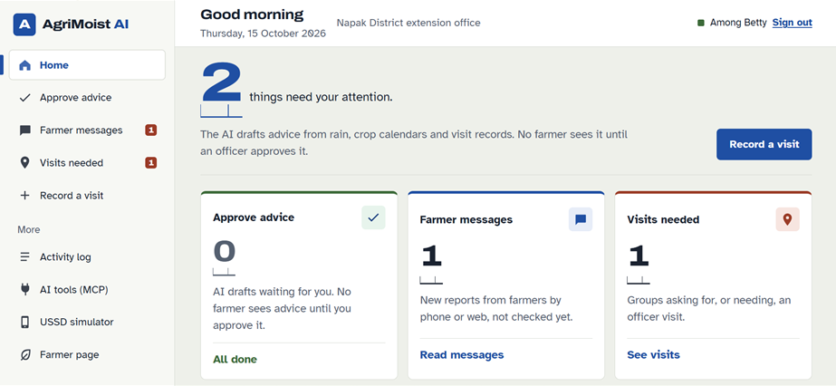
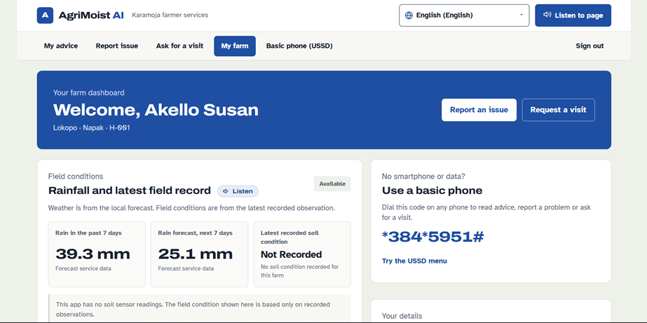
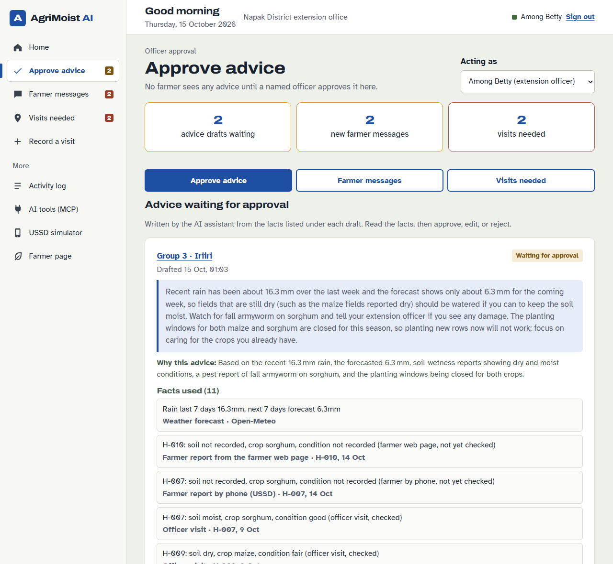
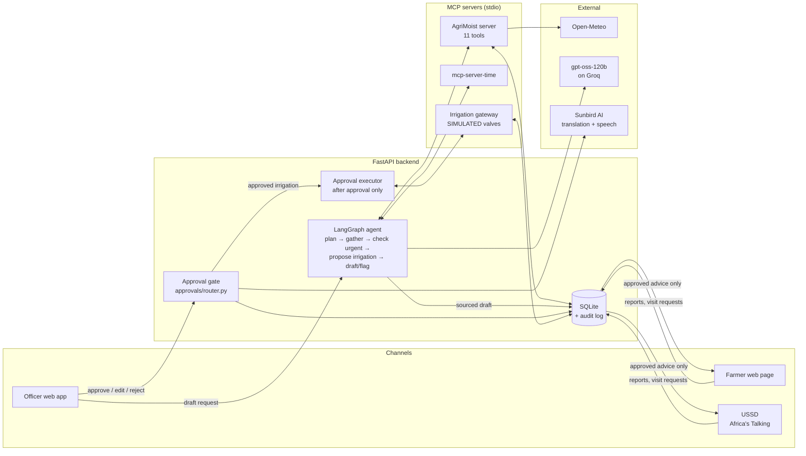
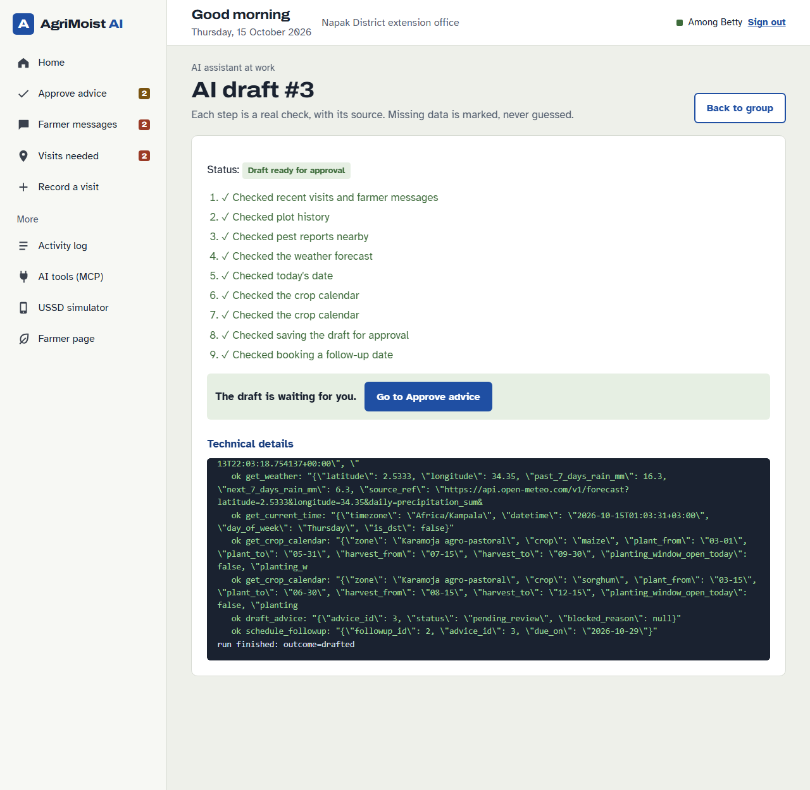
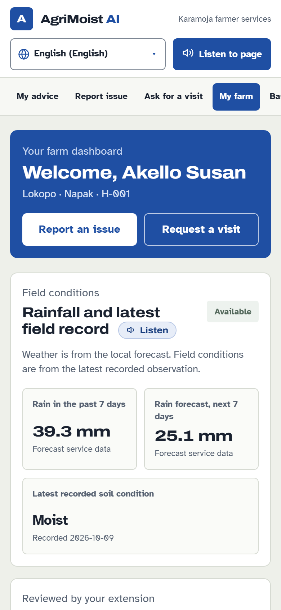
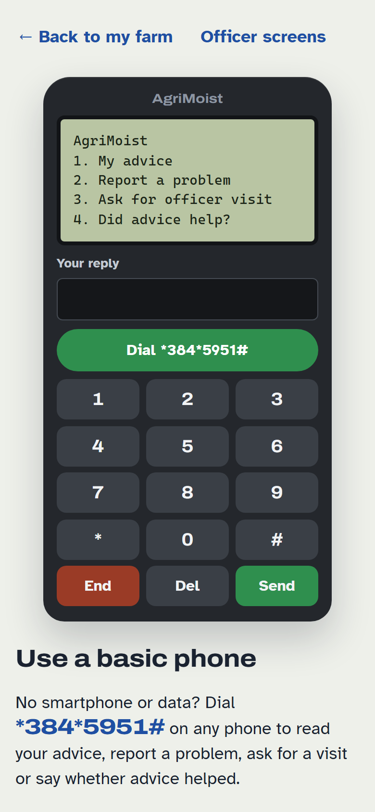
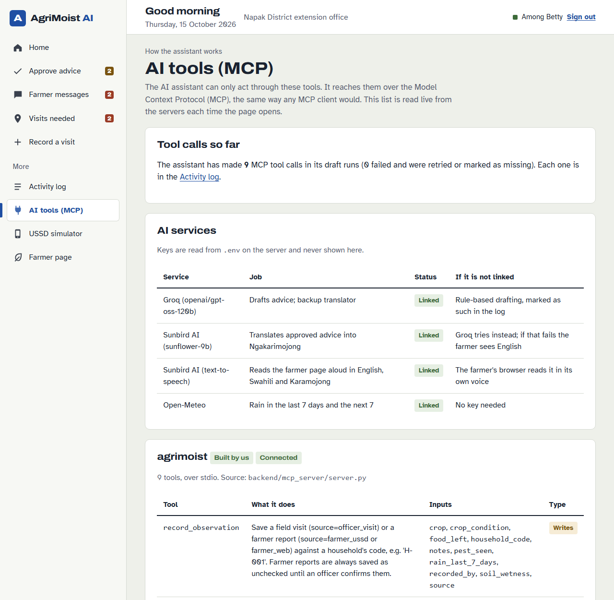

<div align="center">

# AgriMoist AI

**An agentic field assistant for agricultural extension officers in Karamoja, Uganda.**

The agent turns weather, pest and field-visit data into sourced, plot-specific advice.
A named extension officer approves every word before it reaches a farmer.
The AI drafts and proposes; a physical action happens only after a named officer approves.

Demo video (under 3 min): https://www.youtube.com/watch?v=nb6u-yo-OVU

[](https://www.python.org/)
[](https://fastapi.tiangolo.com/)
[](https://github.com/langchain-ai/langgraph)
[](https://modelcontextprotocol.io/)
[](LICENSE)

[**Live demo**](https://agri-moist-ai.onrender.com) ·
[**Quick start**](#quick-start-clone-and-run-with-one-command) ·
[Architecture](ARCHITECTURE.md) ·
[Evaluation results](EVALS.md) ·
[API contract](docs/API_CONTRACT.md) ·
[Tool contract](docs/TOOL_CONTRACT.md)

</div>

---

> **Agentic AI for Africa Challenge** · Agriculture & Food Security track · Climate-smart advisory theme

| 11 | 2 | 55 / 60 | 301 | ~$0.0008 |
| :---: | :---: | :---: | :---: | :---: |
| MCP tools in our server | MCP servers used by the agent | Evaluation score (2026-11-13) | Automated tests | Model cost per agent run |

<p align="center">
  
  
</p>
<p align="center"><em>Left: the extension officer's home screen. Right: the farmer's dashboard.</em></p>

## Table of contents

- [The problem](#the-problem)
- [The solution](#the-solution)
- [Key features](#key-features)
- [Architecture](#architecture)
- [Technology stack](#technology-stack)
- [Getting started](#getting-started)
- [Configuration](#configuration)
- [Demo walkthrough](#demo-walkthrough)
- [Safety guarantees](#safety-guarantees)
- [MCP integration](#mcp-integration)
- [Evaluation](#evaluation)
- [Data sources](#data-sources)
- [Testing](#testing)
- [Project structure](#project-structure)
- [Known limitations](#known-limitations)
- [Roadmap](#roadmap)
- [Team](#team)
- [Acknowledgements](#acknowledgements)
- [Licence](#licence)

## The problem

District extension offices in Karamoja, such as the Napak District Production Office,
have one or two officers serving far more smallholder households than they can visit in
a season. Advice that fits a plot means cross-checking each household's plot history
against rainfall, pest sightings and the crop calendar. By hand, that does not scale, so
most households never get timely advice for their own plot.

Karamoja has a single, unreliable rainy season. Advice that comes late or is wrong costs
a household its harvest.

## The solution

AgriMoist AI gives each officer an AI assistant that does the checking and drafting.
The officer keeps the judgement.

1. **Collect.** Officers record field visits. Farmers report pests, rain and crop problems from any phone.
2. **Check.** The agent gathers plot history, live weather, nearby pest reports, soil moisture from a simulated sensor and the crop calendar through MCP tools.
3. **Draft.** An open-weights model writes advice in which every fact cites its source. Urgent cases are flagged for a visit instead.
4. **Approve.** A named officer approves, edits or rejects each draft. Nothing reaches a farmer without that approval.
   The agent can also propose irrigating a dry plot; a **simulated** valve opens only after the officer approves that proposal.
5. **Follow up.** Farmers read approved advice by USSD or on the web, in English or Ngakarimojong, and say whether it helped.


<p align="center"><em>A real draft from <code>gpt-oss-120b</code> waiting for an officer. Each fact shows where it came from: Open-Meteo, a farmer's USSD report, an officer visit or the FEWS NET crop calendar.</em></p>

**Users**

| User | What they do |
| --- | --- |
| Extension officers | Record visits, review sourced drafts, approve advice, respond to flagged households |
| Farming households | Read approved advice, report problems, request visits and give feedback, on a basic phone (USSD) or a smartphone |

## Key features

- **Auditable agent pipeline.** A fixed LangGraph flow (plan → gather → check urgent → propose irrigation → draft or flag) with live step-by-step progress streamed to the officer.
- **Human-in-the-loop approval gate.** Farmers only ever read from a database view that contains approved advice.
- **Source-checked drafts.** A draft with an unsourced fact, or with a number that appears in none of its sources, is blocked before it reaches the queue.
- **Graceful degradation.** A failed call to our own MCP tools is retried once and then recorded as a visible gap; a failed borrowed-clock call is recorded as a gap without a retry. The agent never guesses a missing value.
- **Two MCP servers for the agent.** Our own 11-tool AgriMoist server (6 read, 5 write), plus the borrowed reference server `mcp-server-time`, both connected over stdio.
- **Simulated irrigation, approval first.** A third MCP server, a **simulated** irrigation gateway (`open_valve`, `close_valve`, `valve_status`; no real hardware), is never connected to the agent. The agent can only call `propose_irrigation`; the rule (current dry soil reading, known weather below the heavy-rain threshold, no open proposal) is checked in code. A named officer approves the proposal through the same gate as advice, on the web or by USSD; only then does a server-side approval executor open the valve. It closes itself after the set minutes, and any error leaves it closed.
- **Basic-phone access.** A USSD menu compatible with Africa's Talking, plus an in-browser handset simulator.
- **Local language.** Approved advice is translated into Ngakarimojong by Sunbird AI. Translations that change any number are rejected.
- **Voice reader.** Farmers can have their page read aloud in English, Swahili or Karamojong, using Sunbird AI's Ugandan voices. Speech is generated in short pieces and prepared in the background when the page opens. Each piece is generated once, stored by the app, and kept by the phone, so listening again uses no data.
- **Built for weak signal.** The farmer page keeps a copy of the farmer's own data on the phone. It opens instantly, and when there is no connection it still shows the last approved advice, clearly labelled as saved. Signing out removes the copy, because farm phones are often shared.
- **Full audit log.** Every agent tool call, officer decision and saved farmer action is logged with its inputs, outputs, source, actor and cost. Voice playback, sign-ins and the weather shown on the screens are not logged.

## Architecture



The agent lives in `backend/agent/graph.py`. Each call to our own tools is retried once,
and a second failure is written into the draft as a gap. A failed call to the borrowed
clock is not retried; it is recorded as a gap. Urgent signals (no food left, an overdue
visit, a food-related visit request) route the group to `flag_for_visit` instead of
drafting advice. The agent is connected to M1 and M2 only; the simulated irrigation
gateway (M3) is reached only by the approval executor. See
[ARCHITECTURE.md](ARCHITECTURE.md) for the full design.

## Technology stack

| Layer | Choice |
| --- | --- |
| Language | Python 3.12 |
| Web framework | FastAPI, uvicorn, Jinja2 templates with plain JavaScript (no build step, light on weak connections) |
| Agent | LangGraph |
| Tools | Official `mcp` Python SDK (FastMCP); borrowed [`mcp-server-time`](https://pypi.org/project/mcp-server-time/) |
| Model | [`openai/gpt-oss-120b`](https://huggingface.co/openai/gpt-oss-120b) (open weights, Apache 2.0), served by [Groq](https://groq.com); deterministic rule-based fallback when no key is set |
| Translation and speech | [Sunbird AI](https://sunbird.ai): `sunflower-9b` translation and Orpheus text-to-speech |
| Persistence | SQLite via SQLModel / SQLAlchemy |
| External data | [Open-Meteo](https://open-meteo.com) weather; [FEWS NET](https://fews.net) crop calendar |
| Testing | pytest (301 tests) and a 20-task evaluation harness |
| Deployment | Docker and Docker Compose; hosted demo on Render |

## Getting started

### Quick start: clone and run with one command

The only requirement is [Python 3.12 or newer](https://www.python.org/downloads/) and Git.
No API keys are needed: without them the app runs end to end in its built-in
rule-based mode.

**macOS / Linux**

```bash
git clone https://github.com/VictoriaMirembe/Agri-moist-AI.git && cd Agri-moist-AI && ./run.sh
```

**Windows (PowerShell)**

```powershell
git clone https://github.com/VictoriaMirembe/Agri-moist-AI.git; cd Agri-moist-AI; .\run.bat
```

Then open **<http://localhost:8000>** for the officer screens and
**<http://localhost:8000/farmer>** for the farmer page. You can also double-click
`run.bat` in File Explorer.

The script:

1. Finds Python 3.12+
2. Creates a virtual environment in `.venv`
3. Installs the requirements
4. Creates `.env` from `.env.example`
5. Starts the app, which creates and seeds its database on first start

Running it again skips the steps that are already done, so later starts take only a
few seconds. To use a different port, set `APP_PORT` (for example `APP_PORT=8080 ./run.sh`).

To enable the real model, Karamojong translation and Sunbird voices, add your keys to
`.env` (see [Configuration](#configuration)) and run the script again.

### Run with Docker

```bash
git clone https://github.com/VictoriaMirembe/Agri-moist-AI.git
cd Agri-moist-AI
cp .env.example .env
docker compose up --build
```

Open <http://localhost:8000>. On first start, the app creates its database and loads the
synthetic demo households.

### Run manually (without the script)

```bash
python -m venv .venv
source .venv/bin/activate          # Windows: .venv\Scripts\activate
pip install -r requirements.txt
cp .env.example .env
uvicorn backend.main:app --reload
```

<details>
<summary><strong>Windows (PowerShell) notes</strong></summary>

Use the standard Windows CPython from python.org, not the MSYS runtime:

```powershell
py -3.12 -m venv .venv
.\.venv\Scripts\python.exe -m pip install --upgrade pip
.\.venv\Scripts\python.exe -m pip install --only-binary=:all: -r requirements.txt
.\.venv\Scripts\python.exe -m uvicorn backend.main:app --reload
```

`--only-binary=:all:` installs published wheels only, so pip never tries to compile
Pydantic or other dependencies from source.

</details>

## Configuration

All settings are read from `.env`. See [`.env.example`](.env.example) for the full list.

| Variable | Purpose | Default |
| --- | --- | --- |
| `GROQ_API_KEY` | Enables the open-weights model for drafting. Blank = rule-based mode, labelled `rule-based-stub` in every run log. | blank |
| `GROQ_MODEL` | Drafting model | `openai/gpt-oss-120b` |
| `SUNBIRD_API_KEY` | Enables Karamojong translation and the Sunbird voice reader. Blank = farmers see English and the voice reader uses the browser's voice. | blank |
| `SESSION_SECRET` | Signs officer session cookies. Blank = a new random key on each start. | blank |
| `OFFICER_DEMO_PASSWORD` | Password for the officer sign-in page, shown there as the demo login. Change it on a public host. | `napak2026` |
| `USSD_SERVICE_CODE` | Short code shown in the simulator | `*384*5951#` |
| `USSD_CALLBACK_TOKEN` | Shared secret required on the Africa's Talking callback URLs | blank |
| `WEATHER_FAIL` | `1` forces `get_weather` to fail, to demonstrate the retry-and-gap behaviour | `0` |
| `SOIL_SENSOR_FAIL` | `1` forces `get_soil_moisture` (the simulated soil sensor) to fail, to demonstrate the retry-and-gap behaviour | `0` |
| `WEATHER_OVERRIDE_PAST_MM` / `WEATHER_OVERRIDE_NEXT_MM` | Forces a rain scenario for demos and evals. Always labelled `demo-override`, never shown as a live reading. | unset |
| `HEAVY_RAIN_THRESHOLD_MM` | Forecast rain (mm, next 7 days) at or above which watering advice is blocked and no irrigation is proposed | `15` |
| `IRRIGATION_DRY_THRESHOLD_PCT` | A plot is proposed for (simulated) irrigation only if its current soil reading is below this | `15` |
| `IRRIGATION_DEFAULT_MINUTES` / `IRRIGATION_MAX_MINUTES` | Minutes the agent proposes, and the cap on every proposal and valve opening | `20` / `30` |
| `IRRIGATION_GATEWAY_FAULT` | `open_fails` or `no_confirmation` makes the simulated gateway fail, to show the valve is left closed | blank |

Open-Meteo needs no key. API keys: [Groq](https://console.groq.com/keys) · [Sunbird AI](https://api.sunbird.ai).

## Demo walkthrough

Watch the recorded demo first: https://www.youtube.com/watch?v=nb6u-yo-OVU

The demo uses synthetic data for 10 households in 2 villages and 3 household groups.
No real person's data is used.

| Step | Where | What to look for |
| --- | --- | --- |
| 1 | **Officer sign-in** → **Home** | Choose an officer and use the demo login (password `napak2026`), then open a household group |
| 2 | Group → **Draft advice** | Agent steps stream in live; raw tool calls and sources are under *Technical details* |
| 3 | **Approve advice** | Each claim shows its source and gaps are highlighted. Approve, edit and approve, or reject |
| 4 | **Farmer page** (`/farmer`) | Sign in as `+256700000001` to `+256700000010`. Only approved advice appears. Try **Listen** |
| 5 | **USSD simulator** (`/ussd`) | Dial `*384*5951#` and press `1`. The same approval rule holds on a basic phone |
| 6 | **Activity log** | Every tool call, with its MCP server, source, actor and per-run cost |
| 7 | **AI tools (MCP)** (`/mcp`) | Both MCP servers are started and their tools listed live over the protocol |

<p align="center">
  
  
  
</p>
<p align="center"><em>Left: an agent run, each step a real MCP tool call. Middle: the farmer page on a phone. Right: the USSD menu on a basic phone.</em></p>

Officer and farmer screens share one database and refresh every 30 seconds. A farmer's
report shows up on the officer's screens, and an officer's decision shows up on the
farmer's page, without a reload.

**To see a failure handled:** set `WEATHER_FAIL=1`, restart, and draft again. The agent
retries once, then writes *"weather missing, check before approving"* into the draft
instead of inventing a rain figure.

## Approving by phone (officer USSD)

An extension officer can approve or reject drafts from a basic phone, with no web app.
In the simulator (`/ussd`) press **Officer: dial `*384*5952#`**, then enter the officer id and PIN.

| Officer | Officer id | Demo PIN |
|---|---|---|
| Among Betty | `1` | `1234` |
| Lomuria Peter | `2` | `5678` |

These are demo PINs seeded by `backend/db/seed.py`; change them before any real use. Only a
salted scrypt hash of each PIN is stored (`backend/officer/pins.py`). Three wrong PINs in a
row lock that officer's USSD sign-in for 15 minutes.

- The menu lists up to 3 drafts waiting, newest first. Pick one, then `1` Approve, `2` Reject (choose a reason from a fixed list) or `0` Back. Editing stays on the web.
- USSD calls the same approval gate as the web (`load_decidable` and `apply_decision` in `backend/approvals/router.py`). The decision records the officer who signed in and is logged with `channel` `ussd` (web decisions log `web`).
- **Expiry.** A draft waiting longer than `DRAFT_EXPIRY_HOURS` (default 72) becomes `expired` and cannot be approved on any channel; both show "Expired: please re-draft". The check lives in the gate, so no channel can skip it.
- **Decide once.** A draft that is already decided is never acted on again: USSD answers with its current status, the web answers 409 as before. This also covers a gateway resending a request on a weak network.

## Safety guarantees

These rules are enforced in code, not just stated in the prompt.

| Guarantee | How it is enforced |
| --- | --- |
| **The AI drafts and proposes; a physical action happens only after a named officer approves.** It cannot send messages, order inputs, request credit or open a valve. | No send, order or credit tool or route exists (EVALS task 9 confirms an order request returns 404). The valve tools are on a separate, **simulated** irrigation gateway server that the agent is never connected to (tested in `tests/test_irrigation.py`). Only the approval executor (`backend/approvals/irrigation_executor.py`) calls them, after the approval is committed, and the gateway itself refuses to open a valve for a proposal without an officer's approval. |
| Irrigation is proposed only when the facts allow it | `propose_irrigation` checks in code: the plot's latest soil reading is current and below `IRRIGATION_DRY_THRESHOLD_PCT`, the weather is known and forecast rain is below `HEAVY_RAIN_THRESHOLD_MM`, and the plot has no open proposal. A missing or stale reading, or a weather gap, means no proposal. |
| A valve never stays open | Minutes are capped at `IRRIGATION_MAX_MINUTES`. Each valve stores its close time and closes itself; the app also closes any overdue valve on start-up. Any error while opening leaves the valve closed. |
| Nothing reaches a farmer without a named officer's approval | `backend/approvals/router.py` is the only code that can set an approved status (apart from one pre-approved record in the demo seed data). Farmer channels read only from the `advice_visible_to_farmer` view, which never contains irrigation proposals. Irrigation proposals use the same gate, so sign-in, expiry, decide-once and both channels apply to them too. |
| Every fact cites a source | A draft with an unsourced fact is set to `blocked` and cannot be approved (409). |
| No invented numbers | A draft whose wording contains a number found in none of its sources is blocked. |
| Missing data is never guessed | After one retry, the gap is written into the draft in plain words. |
| Every action is traceable | Agent tool calls, decisions and saved farmer actions are logged with inputs, outputs, time, source, actor and cost (`backend/logging/tool_log.py`). Voice playback, sign-ins and on-screen weather are not. |
| Translations keep the numbers | A translation that changes or drops a number is discarded, and the farmer sees the approved English text. |

## MCP integration

Our tool server (`backend/mcp_server/server.py`) is a standard stdio MCP server. It
exposes eleven tools: six that only read and five that write. None of them can contact a
farmer or open a valve.

| Tool | Type | Purpose |
| --- | --- | --- |
| `get_field_records` | Read | Recent visits and farmer reports for a household group |
| `get_plot_history` | Read | A plot's past crops, planting dates and harvests |
| `get_crop_calendar` | Read | Planting and harvest windows for a crop in its agroclimatic zone |
| `get_weather` | Read | The past 7 days' rainfall and the 7-day forecast (Open-Meteo) |
| `get_pest_reports` | Read | Nearby pest sightings from visits and farmer reports |
| `get_soil_moisture` | Read | Latest soil-moisture reading per plot from a **simulated** sensor (no real hardware), with its time; readings older than 24 hours are marked stale |
| `record_observation` | Write | Saves a field visit or farmer report, tagged by source |
| `draft_advice` | Write | Queues sourced advice for approval; blocks it if any fact is unsourced |
| `flag_for_visit` | Write | Flags a household group for an urgent officer visit |
| `schedule_followup` | Write | Books a follow-up date |
| `propose_irrigation` | Write | Puts an irrigation proposal for one plot (**simulated** valve) into the officer's approval queue, only if the rule in code allows it; minutes capped. Never opens a valve |

**Simulated device server:** `backend/irrigation_server/server.py` (`irrigation-gateway`)
stands in for an irrigation gateway. There is no hardware: valve state is a database
row. Its three tools are `open_valve`, `close_valve` and `valve_status`, and every call is
logged. The agent's MCP client never connects to it; only the approval executor does,
after a named officer approves.

**Borrowed server:** [`mcp-server-time`](https://pypi.org/project/mcp-server-time/)
supplies an authoritative "today" in Africa/Kampala time, which the agent uses to judge
whether a planting window has closed. Timezone-safe date handling is a small, solved
problem, so we borrowed it rather than rebuilding it.

### How the agent uses MCP

The agent does not call any external API directly. Every fact it uses in advice and every
record it writes goes through an MCP tool call; the only direct database reads are the
group's location in the plan step and open visit requests in the urgency check. For each run,
[`backend/agent/mcp_client.py`](backend/agent/mcp_client.py) starts both servers as
stdio subprocesses, performs the MCP handshake, and calls tools by name over the
protocol, exactly as any third-party MCP client would. Because of this, the server can
be reused unchanged by other agents and tools.

### Where MCP appears in the app

| Where | How to open it | What it shows |
| --- | --- | --- |
| **AI tools (MCP)** page | Officer sidebar → **More** → **AI tools (MCP)**, or `/mcp` | Starts both agent servers live and lists every tool they report over the protocol, with inputs and a read/write label. The simulated irrigation gateway is listed separately, marked as not connected to the agent. Also shows the total number of MCP calls made so far and which AI services are linked. Nothing on this page is hard-coded. |
| MCP status API | `GET /api/mcp` | The same information as JSON, for scripts and monitoring |
| **AI draft** screen | Group → **Draft advice** → **Technical details** | Each MCP call streamed live as it happens, e.g. `-> MCP call agrimoist.get_weather (attempt 1) {...}`, including retries |
| **Activity log** | Officer sidebar → **More** → **Activity log**, or `/log` | Every call the assistant made, labelled with the MCP tool and the server that handled it (`agrimoist` or `mcp-server-time`) |



### Connect your own MCP client

The AgriMoist server is a standard stdio MCP server, so you can use it outside this
app. Run these commands from the repository root after the [quick start](#quick-start-clone-and-run-with-one-command),
which creates `.venv`. The `--demo-data` flag creates and seeds the database if it
does not exist yet.

**Option 1: MCP Inspector (browser UI, needs Node.js)**

```bash
# macOS / Linux
npx @modelcontextprotocol/inspector .venv/bin/python -m backend.mcp_server.server --demo-data
# Windows
npx @modelcontextprotocol/inspector .venv\Scripts\python.exe -m backend.mcp_server.server --demo-data
```

The Inspector opens in your browser. Choose **Connect**, then **Tools** → **List Tools**,
then pick a tool, fill in its inputs (for example `get_field_records` with
`group_id` `1`) and choose **Run Tool**.

**Option 2: Claude Code or another client that reads [`.mcp.json`](.mcp.json)**

The repository already registers both servers in `.mcp.json`. Activate the virtual
environment (`source .venv/bin/activate`, or `.venv\Scripts\activate` on Windows), start
the client from the repository root, and approve the project's MCP servers when
prompted. Then ask, for example: *"Use the agrimoist tools to show the field records
for group 1 and the weather for its village."*

**Option 3: Claude Desktop or any client configured by file**

Add this to the client's MCP configuration (for Claude Desktop,
`claude_desktop_config.json`), replacing `/path/to/Agri-moist-AI` with the absolute
path of your clone:

```json
{
  "mcpServers": {
    "agrimoist": {
      "command": "/path/to/Agri-moist-AI/.venv/bin/python",
      "args": ["-m", "backend.mcp_server.server", "--demo-data"],
      "env": {
        "PYTHONPATH": "/path/to/Agri-moist-AI",
        "DATABASE_URL": "sqlite:////path/to/Agri-moist-AI/data/agrimoist.db"
      }
    }
  }
}
```

On Windows, use `C:/path/to/Agri-moist-AI/.venv/Scripts/python.exe` as the command and
`sqlite:///C:/path/to/Agri-moist-AI/data/agrimoist.db` as the database URL. Restart the
client after saving the file.

> The same safety rules apply to every client. The write tools only save drafts, flags,
> observations, follow-up dates and irrigation proposals. Nothing reaches a farmer, and
> no (simulated) valve opens, until a named officer approves it in the app.

## Evaluation

[`scripts/run_evals.py`](scripts/run_evals.py) runs 20 scenario tasks, 3 times each,
against the real stack. Each run uses a fresh database, real MCP subprocesses and the real
`gpt-oss-120b` model.

| Round | Score | Change before the round |
| --- | --- | --- |
| Round 1 | 32/42 | Baseline |
| Round 2 | 31/42 | Prompt changes; stricter pass conditions |
| Round 3 | 36/42 | Pass conditions refined |
| Final check | 37/42 | Translation moved to Sunbird AI |
| Re-run (2026-10-15) | 39/42 | Approvals need a signed-in officer; no task, prompt or agent change |
| New features (2026-11-12) | 47/57 | 5 tasks added (USSD approval, wrong PIN, expiry, decide-once, stale soil reading). Tasks 1-14: 35/42 |
| Rain guard, first run (2026-11-13) | 51/57 | Code blocks watering advice before heavy rain; sensor readings quoted exactly; task 9 tool list updated to ten. Tasks 1-14: 36/42 |
| Rain guard, final (2026-11-13) | 53/57 | Guard bug fixed (it blocked "says not to add water"); nothing else changed. Tasks 1-14: 38/42 |
| Simulated irrigation, first run (2026-11-13) | 54/60 | Task 20 added (irrigation loop): 3/3. No existing task changed, so task 9 still expected ten tools and failed 0/3 with the eleventh (`propose_irrigation`). Tasks 1-14: 36/42 |
| **Simulated irrigation, re-run (2026-11-13)** | **55/60** | Task 9's tool list updated to eleven; nothing else changed. Task 9 3/3, task 20 3/3, task 2 0/3 (see below). Tasks 1-14: **37/42** |

On 2026-11-12, tasks 1-14 dropped from 39/42 to 35/42. Task 9 went to 0/3 because its
check still expects exactly nine tools and the server now has ten (the read-only
`get_soil_moisture`); the order route still returns 404. Task 2 fell to 0/3 and task 10 to
2/3. The new approval tasks (15-18) passed 12/12. On the stale-reading task (19), the
stale value never appeared in any run, but 2 of 3 drafts were blocked because the model
rounded sensor readings to numbers no source contains. The other safety tasks passed in
every run: weather outage, overdue visit, food insecurity, officer rejection, missing source
and USSD before approval. All failures are explained in [EVALS.md](EVALS.md).

On 2026-11-13, after adding a rain guard in code and asking the model to quote sensor
readings exactly, the score was 51/57 (tasks 1-14: 36/42). Task 9 passed 3/3 with its
updated tool list, and task 19 passed 3/3 with no rounded readings. Task 2 is still 0/3.
For the first time, all three drafts said not to water before the heavy rain, but the new
guard wrongly blocked them: it read "says not to add water" as advice to add water. Task
11 fell to 1/3 on wording, and task 10 stayed at 2/3.

After that bug was fixed and covered by tests, a final run the same day scored **53/57**
(tasks 1-14: **38/42**, their best in any round), with no draft blocked. Task 2 rose to
2/3. All three drafts told farmers not to water before 45 mm of forecast rain, and the
third failed only because the check does not recognise "says not to add water". Task 11
stayed at 1/3 on wording, and task 10 at 2/3 (Sunbird changed a number, so the farmer
saw the approved English). Task 19 passed 3/3, and every other task 3/3.

The latest run (also 2026-11-13) adds the **simulated** irrigation loop and scored
**54/60**. The new task 20 passed 3/3: the agent proposed "IRRIGATE H-009 20 min" for the
dry plot without calling any valve tool, the valve opened only after the officer
approved, and it closed itself; with 45 mm of forecast rain nothing was proposed. Task 9
fell to 0/3 only because its unchanged check expects exactly ten tools and the server now
has eleven. No ordering or credit tool exists, and the order route still returns 404.
Task 2 rose to 3/3, task 11 stayed at 1/3 on wording ("not advised", "no longer
possible"), and task 10 at 2/3. No draft was blocked.

After task 9's list was updated to eleven tools, a re-run scored **55/60** (tasks 1-14:
37/42). Task 9 and task 20 passed 3/3, and task 10 rose to 3/3. Task 2 fell to 0/3,
although all three drafts said not to water before the heavy rain: two failed on the
check's wording ("says not to add water"), and one was **wrongly blocked by the rain
guard**, which read "wait for the forecast rain rather than irrigate" as advice to
irrigate. That bug is in the safe direction but is not fixed yet. Task 11 stayed at 1/3
on wording.

**Cost and latency** (15 real drafting runs, 2026-11-13 irrigation re-run): about
**$0.0008 per agent run** (mean $0.00081, max $0.00104) and **3.8 s median** per run (mean
5.8 s without one unexplained 437 s run; 34.6 s with it). The full 60-run suite took
19 min 12 s, including that run, and cost $0.0268. Translating one approved draft cost
$0.0004-$0.0009 (the `translation_cost` logged on each of the 12 approvals in
`scripts/evals_results_2026-10-15.json` and `scripts/evals_results_2026-11-12.json`).

## Data sources

| Data | Source | Limitations |
| --- | --- | --- |
| Households, plots, visits | Synthetic, written by the team (`backend/db/seed.py`) | Deliberately includes messy records: a missing planting date, disagreeing soil readings, an overdue visit |
| Rainfall | [Open-Meteo](https://open-meteo.com) | Model forecast, not ground measurement |
| Crop calendar | [FEWS NET Karamoja Livelihood Zones report](https://fews.net/sites/default/files/documents/reports/Karamoja%20Final_LHZ%20Report.pdf) | Sorghum and maize only; seasonal windows |
| Pest reports | Derived from visit and farmer-report records | Only as current as the last record |
| Soil moisture | **Simulated** sensor readings (`SoilReading` table); the seeded ones are demo data (`backend/db/seed.py`) | No real sensor hardware. A reading older than 24 hours is marked stale and never used as current |

## Testing

```bash
pytest                              # 301 tests
docker compose run app pytest       # inside Docker
python scripts/run_evals.py         # 20-task evaluation (uses the real model if a key is set)
```

The test suite always runs in rule-based mode with the external keys cleared, so it
never calls Groq or Sunbird, even when `.env` contains keys.

## Project structure

```
backend/
  agent/          LangGraph agent, MCP client, model and Sunbird clients
  approvals/      Approval gate (the only path to an approved status) and the irrigation approval executor
  core/           Settings and database setup
  db/             SQLModel models and synthetic seed data
  farmer/         Farmer web API, USSD handler, voice endpoints
  logging/        Audit log
  irrigation_server/  SIMULATED irrigation gateway MCP server (3 valve tools; not connected to the agent)
  mcp_server/     AgriMoist MCP server (11 tools)
  officer/        Officer pages, API and sign-in
  tools/          Tool implementations shared by the MCP server
frontend/
  farmer/         Farmer page and USSD simulator templates
  officer/        Officer screens
  static/         Shared CSS and JavaScript
data/             Crop calendar (FEWS NET) and the SQLite database
docs/             API contract, tool contract, user research
images/           Screenshots used in this README
scripts/          Evaluation harness and saved results
tests/            pytest suite
```

## Known limitations

This is a hackathon build. We state its limits plainly.

- **Officer authentication is demo-grade.** Every officer screen and officer API needs a signed session, but all officers share one demo password (`OFFICER_DEMO_PASSWORD`) and choose their name at sign-in. This is not production authentication.
- **Farmer sign-in is a phone-number lookup**, not authentication.
- **The model can still give wrong advice.** See EVALS task 2. Officer approval is the safeguard.
- **Only numbers are checked automatically against the sources**, and only numbers written as digits. The officer reviews the rest of the wording.
- **Karamojong output has not been reviewed by a native speaker.** About one in three translations is rejected by the number check, and the farmer then sees English. Sunbird has no Karamojong voice, so Karamojong is read aloud by its Ateso voice, a closely related language.
- **USSD needs a public URL** set in the Africa's Talking dashboard to go live. No SMS is sent in this build.
- **USSD pest reports cannot name the pest.** The web page lets the farmer choose one.
- **Synthetic data only**, and there is no household registration screen yet.
- **The irrigation valves are simulated.** There is no irrigation hardware: `open_valve` changes a database row, and the officer page shows that simulated state. A real gateway would need its own authentication and a hardware fail-safe; this build only shows the approval-first control flow.
- **The soil-moisture sensor is simulated.** There is no sensor hardware; every reading is labelled `simulated sensor`, and the seeded ones are demo data. Demo readings are timed when the database is first seeded, so on an old database they will all show as stale.
- **Docker was not run in the build environment.** The app was verified with uvicorn and the full test suite; the Docker image uses the same install and start commands.
- Karamojong is read aloud with Sunbird's Ateso voice because no Karamojong voice exists.
- The fixed greeting and field-condition phrases in Karamojong and Swahili were written by the team and have not been checked by a native speaker.
- The Swahili option reads the Karamojong translation when one exists; advice is not translated into Swahili.
- `POST /api/farmer/voice-audio` is not yet restricted to approved advice and its calls are not logged.
- The voice audio cache is on disk and is lost when the free Render instance restarts.
- Since commit `654ed7d`, every officer screen and officer API requires a signed-in officer, but recording a visit, checking a farmer report and marking a visit done still take the officer's id from the request body rather than from the signed-in session. The web sign-in is a shared demo login: its password is shown on the sign-in page so judges can try the app. Production would need a password or a one-time code (OTP) for each officer. The officer USSD menu already uses a separate PIN for each officer, with lockout after repeated wrong PINs.

## Roadmap

- **Live SMS and USSD** through Africa's Talking, with sending only after officer approval
- **Offline-first farmer app** as an installable PWA
- **Multi-district rollout.** Every record already carries a district, so each district can have its own queue, officers, languages and crop calendar
- **PostgreSQL** for multi-office use. This is a connection-string change, because the app already uses SQLAlchemy
- **Photo reports** from smartphone users, to support the officer's diagnosis
- **Community alerts** through the same approval gate, for example outbreak warnings
- **Officer registration** of households with recorded consent

## Team

| Name | Role |
| --- | --- |
| **Victoria Mirembe Ssekajja** | **Team lead**; officer app and approval gate |
| Ashelycole Niwasiima | Core agent and backend |
| Evans Rwothomio | Farmer channels and data |

## Acknowledgements

- [`mcp-server-time`](https://pypi.org/project/mcp-server-time/), from the Model Context Protocol project (MIT)
- [FEWS NET](https://fews.net) for the Karamoja crop calendar
- [Open-Meteo](https://open-meteo.com) for weather data
- [Sunbird AI](https://sunbird.ai) for Karamojong translation and Ugandan text-to-speech
- [Groq](https://groq.com) for serving `gpt-oss-120b`

## Licence

Released under the [MIT Licence](LICENSE).
